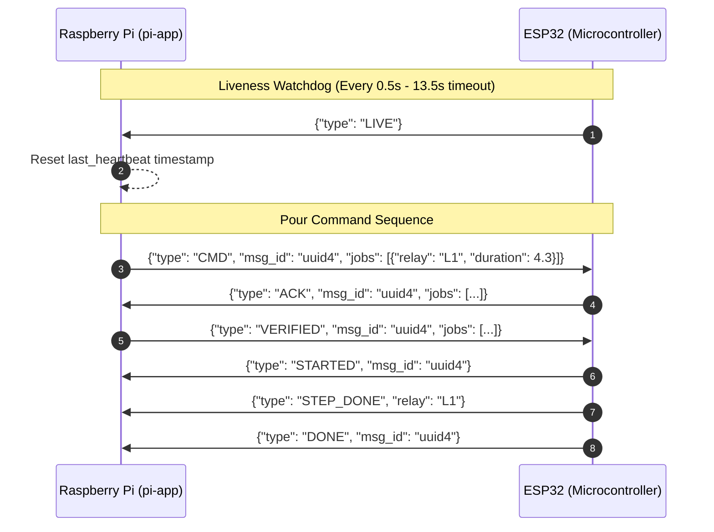
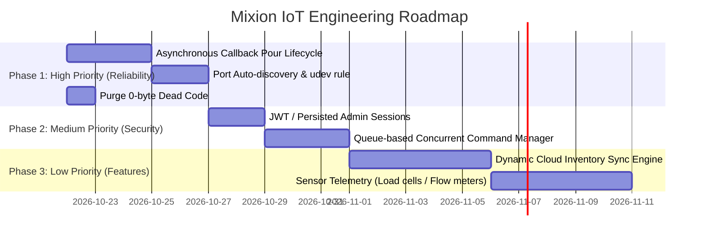

# 🍹 Complete IoT System Analysis Report: Mixion Edge Dispenser

An in-depth technical analysis of the **Mixion Raspberry Pi IoT Drink Dispensing System** (`pi-app`), evaluating its embedded hardware architecture, serial communication protocols, dispensing engine, database integrity, edge API, and touch-kiosk interface.

---

## 1. Executive Summary

The **Mixion Pi App** is an edge-computing IoT kiosk designed for automated cocktail and beverage dispensing. The system bridges an interactive touch-screen user interface with real-world fluid dispensing actuators:

```
┌────────────────────────────────────────────────────────┐
│                   Raspberry Pi 4 / Edge                │
│                                                        │
│  ┌──────────────────────┐      ┌────────────────────┐  │
│  │ Touch Kiosk Frontend │ ───> │  FastAPI Backend   │  │
│  │ (HTML5/CSS3/Vanilla) │      │  (Uvicorn on :8000)│  │
│  └──────────────────────┘      └─────────┬──────────┘  │
│                                          │             │
│                                ┌─────────▼──────────┐  │
│                                │   SQLite Database  │  │
│                                │ (WAL Mode / Migr.) │  │
│                                └─────────┬──────────┘  │
│                                          │             │
│                                ┌─────────▼──────────┐  │
│                                │   SerialClient     │  │
│                                │ (Daemon Threads)   │  │
│                                └─────────┬──────────┘  │
└──────────────────────────────────────────┼─────────────┘
                                           │ UART / USB Serial
                                           │ (/dev/ttyUSB0 @ 115200)
┌──────────────────────────────────────────▼─────────────┐
│                 ESP32 Microcontroller                  │
│                                                        │
│  ┌──────────────┐      ┌────────────────────────────┐  │
│  │ State Engine │ ───> │ Relay Controller / Drivers │  │
│  └──────────────┘      └──────────────┬─────────────┘  │
└───────────────────────────────────────┼────────────────┘
                                        │ GPIO / High-Current Switching
                         ┌──────────────┴──────────────┐
                         ▼                             ▼
                 [Peristaltic Pump 1]          [Solenoid Valve N]
```

### Key Highlights
- **Communication Topology**: Microcontroller offloading model via USB-Serial UART (`/dev/ttyUSB0`, 115200 baud). The Raspberry Pi acts as the high-level brain (UI, recipes, business logic, stock management), while an ESP32 acts as the real-time hardware execution unit.
- **Fail-Safe Mechanism**: Heartbeat monitoring marks the hardware **OFFLINE** if no message is received within 13.5 seconds, automatically disabling unavailable drinks on the customer-facing kiosk.
- **Volumetric Accuracy**: Combines flow-rate actuation timing with customizable software calibration profiles (percentage-based or direct mL volume offset).

---

## 2. Hardware & Embedded Communications Subsystem

The physical actuation interface is managed by `hardware/serial_client.py`.

### 2.1 Communication Protocol & Frame Architecture
- **Transport**: PySerial connection over USB serial (`/dev/ttyUSB0`), baud rate: `115200`, with `DTR=False` and `RTS=False` to prevent unintentional auto-resetting of the ESP32 on connection open.
- **Framing**: Newline-terminated (`\n`) JSON payloads.
- **Payload Auto-Sanitization**:
  The parser contains automatic self-healing logic (`serial_client.py:L119-L130`):
  1. **Garbage Frame Trimming**: Finds outermost braces `{ ... }` to strip noise bytes or bootloader chatter.
  2. **Unquoted Key Normalization**: Uses regex `([\{,])\s*([a-zA-Z0-9_]+)\s*:` to auto-quote non-standard keys emitted by microcontrollers (e.g., `{type:"LIVE"}` $\to$ `{"type":"LIVE"}`).

### 2.2 Handshake & Message Protocol



| Message Type | Direction | Payload Parameters | Purpose |
| :--- | :--- | :--- | :--- |
| `LIVE` | ESP $\to$ Pi | `{}` or status data | Heartbeat message indicating microcontroller is running |
| `CMD` | Pi $\to$ ESP | `{"msg_id": str, "jobs": [{"relay": str, "duration": float}]}` | Initiates liquid dispensing across line relays |
| `ACK` | ESP $\to$ Pi | `{"msg_id": str, "jobs": [...]}` | ESP confirms command reception and echo-verifies parameters |
| `VERIFIED` | Pi $\to$ ESP | `{"msg_id": str, "jobs": [...]}` | Final authorization from Pi to trigger physical high-current relays |
| `STARTED` | ESP $\to$ Pi | `{"msg_id": str}` | Actuation sequence has physically begun |
| `STEP_DONE`| ESP $\to$ Pi | `{"relay": str}` | Single line dispensing completed |
| `DONE` | ESP $\to$ Pi | `{"msg_id": str}` | Entire recipe dispense finished |
| `DISCARDED`| ESP $\to$ Pi | `{}` | ESP dropped job due to collision or invalid state |
| `ERROR` | Both | `{"reason": str}` | Execution or verification error |

### 2.3 Resiliency & Mock Serial Mode
When `use_mock_serial: true` is configured in `config.json` or if `pyserial` is missing:
- Real serial device initialization is skipped.
- Simulated responses (`ACK` at +100ms, `STARTED` at +500ms) are generated via `threading.Timer` (`serial_client.py:L208-L210`).
- `device_online` is hardcoded to `True`, allowing full system simulation without attached hardware.

---

## 3. Pouring & Dispensing Engine Analysis

The pour calculation and validation logic resides in `services/pour_service.py`.

### 3.1 Flow Rate & Calibration Math
The hardware uses duration-based volumetric displacement. Dispense timing is governed by:

$$\text{Duration (seconds)} = \left(\frac{\text{Calibrated Amount (mL)}}{\text{Flow Rate (mL/s)}}\right) + 0.3$$

- The **`+ 0.3s` constant** accounts for motor spin-up latency, tubing elasticity, and relay trigger delays (`pour_service.py:L10`).
- **Hardware Calibration Types**:
  - `percentage`: $\text{Adjusted} = \text{Amount} \times \left(1 + \frac{\text{CalibrationValue}}{100}\right)$
  - `volume`: $\text{Adjusted} = \text{Amount} + \text{CalibrationValue}$
  - `none`: $\text{Adjusted} = \text{Amount}$
  - Result clamped with $\max(0.0, \text{Adjusted})$ to prevent negative pouring values.

### 3.2 Pre-Flight Safety Checks
Before any relay command is issued, `PourService.dispense()` executes a multi-point validation:
1. **Device Liveness Check**: Rejects with `HTTP 409: Hardware Offline` if the ESP32 heartbeat is timed out.
2. **Drink Status Check**: Validates that the drink is globally enabled.
3. **Recipe Completeness**: Verifies all drink ingredients have mapped physical bottles.
4. **Bottle Enablement**: Verifies that each assigned bottle is enabled.
5. **Volumetric Stock Check**: Compares `bottles.current_ml` against `recipes.amount_ml`. If any ingredient is insufficient, the pour is blocked with `Low stock for <Ingredient>`.

---

## 4. Data Architecture & Database Integrity

Data storage is managed by `db/database.py` using SQLite with WAL (`Write-Ahead Logging`) enabled for concurrent reads without locking.

### 4.1 Schema Overview

```
 [categories] ──< [ui_groups]
                       │
 [glasses]   ──┐       │
 [methods]   ──┼──< [drinks] ──< [recipes] >── [ingredients] >── [ingredient_types]
               │        │                               │
               │        │                               ▼
               │        │                           [bottles]
               │        │                               ▲
               │        │                               │
               │   [transactions]                    [lines]
               │                               (calibration settings)
               └──< [recipe_extras] >── [extras]
```

### 4.2 Migration Engine (`db/migrate.py`)
- **Idempotent Executions**: Tracks applied versions in `_schema_migrations`.
- **Integrity Validation**: `validate_schema()` inspects `PRAGMA table_info` before server boot to verify 12 tables and all required columns exist.
- **Fail-Safe Startup**: `run.sh` aborts server execution if migration returns a non-zero exit code, preventing silent database corruption.

---

## 5. Kiosk Frontend & API Interface

### 5.1 REST API Routes (`api/routes/`)
- **Client Endpoints**:
  - `GET /api/drinks` & `GET /api/recipes`: Returns drinks combined with dynamic stock status (`available: true/false`), reasons, ingredients, and resolved media URLs.
  - `POST /api/create-order/`: Receives order payload, triggers `PourService.dispense()`.
  - `GET /api/manual-extras/`: Returns optional cocktail extras (garnishes, syrups).
- **Admin Endpoints** (`api/routes/admin.py`):
  - Protected via `X-Admin-Token` header.
  - Full CRUD operations for drinks, ingredients, lines, bottles, and recipes.
  - `POST /api/admin/bottles/{bid}/refill`: One-click bottle replenishment.
  - `GET /api/admin/status`: Real-time hardware health check.

### 5.2 Touch Kiosk UI Features
- **Inactivity Watchdog**: Automatically resets back to the video splash screen (`/static/images/promo.mp4`) after 25 seconds of touch inactivity (`app.js:L1-L15`).
- **Dynamic Snap-Paging**: Dynamically calculates grid columns and rows based on screen viewport dimensions to ensure large touch targets for kiosk touchscreens (`app.js:L46-L67`).
- **Order Concurrency Guard**: Uses `isOrdering` flag to prevent duplicate dispenses caused by rapid multi-tapping (`app.js:L490-L491`).

---

## 6. Codebase Health & Technical Debt Analysis

An audit of the codebase reveals several empty placeholder files representing unfinished or refactored architecture:

| File Path | Size | Status / Assessment |
| :--- | :--- | :--- |
| `app.py` | 0 B | **Orphaned Root File**. The real app entry is `api/app.py` launched via `run.py`. |
| `version.json` | 0 B | **Empty**. Should track release versions or git commits. |
| `hardware/gpio_manager.py` | 0 B | **Empty**. Legacy placeholder when pumps were planned for direct Pi GPIO. |
| `hardware/pump_controller.py`| 0 B | **Empty**. Logic was consolidated directly into `serial_client.py` and `pour_service.py`. |
| `hardware/sensor_reader.py` | 0 B | **Empty**. Flow meter / load cell reading is currently handled on ESP32 or not yet hooked. |
| `services/inventory_service.py` | 0 B | **Empty**. Stock deduction is implemented inside `db/database.py`. |
| `services/order_service.py` | 0 B | **Empty**. Routing delegates directly to `PourService`. |
| `services/recipe_service.py` | 0 B | **Empty**. Recipe querying handled directly by `db/database.py`. |
| `services/sync_service.py` | 0 B | **Empty**. Cloud synchronization placeholder. |
| `db/models/*` (5 files) | 0 B each | **Empty Placeholders**. ORM models not used; raw SQLite queries used instead. |
| `db/repositories/*` (5 files) | 0 B each | **Empty Placeholders**. Repository pattern was abandoned in favor of unified `Database` class. |

---

## 7. Critical Findings, Vulnerabilities & IoT Risks

### ⚠️ Finding 1: Optimistic Fire-and-Forget Inventory Deduction
- **Problem**: In `services/pour_service.py:L66-L72`, `db.deduct_bottles()` and `db.complete_transaction(txn_id, "completed")` are executed **immediately after sending `CMD`** to the serial port.
- **Risk**: If the ESP32 encounters an error, drops the command, or power fails mid-pour, the database records the drink as completed and permanently deducts inventory for a drink that was never dispensed.
- **Recommendation**: Transition transactions through a state machine: `started` $\to$ `pouring` $\to$ `completed` (or `failed`). Deduct inventory only upon receiving `DONE`, or refund inventory if `ERROR` or `DISCARDED` is received from the ESP32.

### ⚠️ Finding 2: SerialClient Single-Command Race Condition
- **Problem**: `SerialClient.current_cmd` (`hardware/serial_client.py:L25`) is a single scalar property on a Singleton instance.
- **Risk**: While the UI has an `isOrdering` flag, direct API calls to `/api/order` can overwrite `self.current_cmd` before the ESP sends `ACK`, causing verification mismatches or state corruption.
- **Recommendation**: Use a thread-safe dictionary keyed by `msg_id` (e.g., `self.pending_commands[msg_id]`) with a lock or an asynchronous dispatch queue.

### ⚠️ Finding 3: In-Memory Token Volatility
- **Problem**: `api/routes/admin.py:L7` stores active authentication tokens in a Python `set()` (`_active_tokens`).
- **Risk**: Any server restart, crash, or reload instantly invalidates all active admin sessions without warning.
- **Recommendation**: Store tokens in the SQLite database or use signed JWTs with expiration timestamps.

### ⚠️ Finding 4: Static Serial Port Path
- **Problem**: `config.json` specifies `"serial_port": "/dev/ttyUSB0"`.
- **Risk**: When multiple USB serial devices are connected, or after a USB disconnect/reconnect cycle on Linux, the device node may enumerate as `/dev/ttyUSB1` or `/dev/ttyACM0`, causing the Pi to lose communication with the ESP32 indefinitely until manual config intervention.
- **Recommendation**: Implement auto-discovery using `serial.tools.list_ports` matching ESP32 VID/PID, or document creating persistent `udev` symlinks (e.g., `/dev/mixion_esp32`).

---

## 8. Prioritized Remediation & Roadmap



### Immediate Recommendations (Next Sprint)
1. **Link Pour Completion to Serial Events**:
   Update `SerialClient._handle_response()` to emit an event or invoke a callback when `DONE` or `ERROR` is received, and update `transactions` accordingly.
2. **Clean Up Dead Code**:
   Delete or properly implement the 0-byte skeleton files (`hardware/gpio_manager.py`, `hardware/pump_controller.py`, `hardware/sensor_reader.py`, `services/*`, `db/models/*`, `db/repositories/*`) to keep the repository clean and maintainable.
3. **Configure Persistent USB Symlink**:
   Add a Linux udev rule:
   ```bash
   # /etc/udev/rules.d/99-mixion-esp.rules
   SUBSYSTEM=="tty", ATTRS{idVendor}=="10c4", ATTRS{idProduct}=="ea60", SYMLINK+="mixion_esp32"
   ```
   and update `config.json` to point to `/dev/mixion_esp32`.
